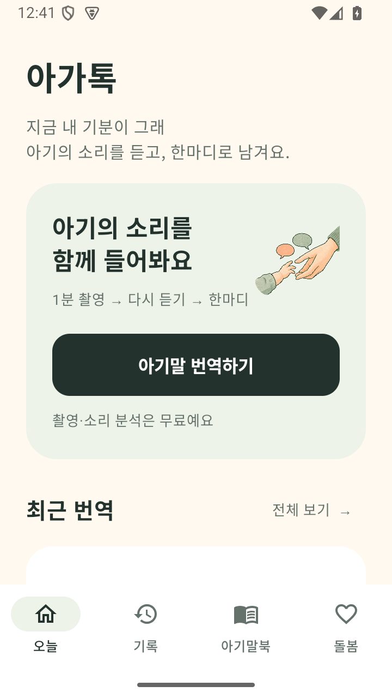
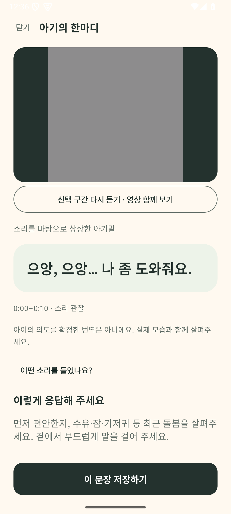

# 아가톡0.5.0/code13 — QA와 남은 품질 문제

> **2026-10-02 후속 상태:** 아래는 0.5.0 당시 실측 기록이다. 이 문서의 아기 웃음 0.668·일반 울음 0.332 충돌 보류는 **0.5.3에서 동일 PCM 재검증으로 해결됐다.** [수정과 실제 재측정](../sound-quality-0.5.3/README.md)을 확인한다. 원문·점수·실행 결과는 당시 근거로 보존하며, 이 사례 해결을 전체 의도 해석 정확도 입증으로 보지 않는다. 현재 0.5.4 QA는 [별도 매트릭스](../ux-quality-0.5.4/MATRIX.md)에 따라 진행 중이다.

2026-10-01. **서명된 실사용 평가 후보. 유료 출시 품질 승인 전.** 새 APK는 `outputs/Agattok-0.5.0-code13.apk`. 이전0.4.5를 덮어쓰지 않았다. 공개 제출·상품 등록·정책 서버 배포는 이번 작업에서 하지 않았다.

## 실제 실행

| 실행 | 결과 | 범위 |
|---|---|---|
| 최종 연결 debug 전체 계측 | 149항목 / **146통과·3조건skip·0실패** | 실제 URL/공개키 빌드. 미설정 전용2항목과 명시적 자료가 필요한 공개음성측정1항목skip. 결과를149/149로 보고하지 않음 |
| 미설정 debug 이전 실행 |147/147통과 | 재생 수정 뒤 별도 실행. 최신 전체 통과 수에 합산하지 않음 |
| 글자200% 추가 검사 |3/3통과 | 결과/근거/고정 저장 버튼,8–11초 구간 재생·분석,보류 안내 노출. ControlledAnalyzer UI검사이며 실제 분류 정확도 아님 |
| 최종 서명 release UI |small·font200 시나리오 통과 |720×1280/320dpi,1080×2400/420dpi·200%. 실제 녹화/재생, 가져오기, 유료/정책 왕복, 실제 모델의 합성순음 보류안내 |
| Node 서버 |56/56통과 |localhost + Google대역. 실제 Play거래 아님 |
| Lint |0오류·15경고 |억제/baseline추가 없음 |
| APK/AAB |서명·16KB ZIP/ELF·백업/공유 범위 통과 |기존 native/model18파일 byte동일. 실제 ARM/OEM 테스트 아님 |
| 공개 음성 실제 모델 |울음 문장1 / 웃음 보류1 / 옹알이 미실행 |정확도 또는 통과율로 환산하지 않음. [출력](public-audio-results.json) |

환경: Windows/JDK21.0.12.101·SDK36·API35 x86_64 AVD MoaQA35/emulator-5554, Gradle worker1. 실제 센서/MediaPlayer는 에뮬레이터 구현이다. 실제폰의 음질/카메라 특성을 검증하지 않았다.

공개 음성 측정 도구는 명시적인 자료와 인자를 넣어 별도로 실행했다. 원본은 앱·Git에 넣지 않았다. Git의 실행 로그는 줄바꿈/행 끝 공백만 정규화했고 원 로그는 로컬QA ZIP에 보존했다. 마지막 변경은 보류 안내 자동 스크롤이며 최종 전체 계측과 서명앱 UI에서 다시 검증했다. [실행 로그](instrumentation.txt), [원시 판정](instrumentation-result.json), [패키지](package-verdict.json), [release UI](release-ui-result.json).

## 재현하고 고친 결함

1. **녹음 없이 문장 생성:** 이전 UI에서 울음/수유 전만 선택해 저장 버튼에 도달하는 실패를 확보. 수동 입력·유형/상황 선택·후보 reroll을 제거했고 새 흐름은 실제 소리 근거를 요구한다. [이전 red재현](no-input-baseline-repro.txt).
2. **군중 소음=옹알이:** `babbl` 부분문자열이 `Hubbub, speech noise, speech babble`와 `Babbling`을 합쳤다. 원 모델 metadata의 정확한 이름으로 분리했다.
3. **AAC 선택 구간 시작 손실:** 초기 seek 때문에341samples가 빠졌다. t=0priming보존·후반250ms preroll·PTS crop으로 수정했고8–11초/0–3초 서로 다른 합성소리를 시험했다.
4. **첫 재생 전 구간 변경 실패:** Prepared 상태에서 pause 호출로 MediaPlayer error(-38) 발생. 실제 로그와 단독 회귀 실패 확보. 재생 중에만 pause하고 seek완료 후 시작한다.
5. **작은 화면에서 분석 보류가 안 보임:** 보류 안내가 viewport아래에 생겨 수동 스크롤해야 보였다. [전후 UI텍스트](hidden-message-repro.jsonl). BringIntoViewRequester로 새 안내가 바로 보이도록 수정했다.
6. **문구의 상황 충돌:** 울음에 놀이 반복을 붙이는 경로 제거. 소리/리듬 의미군 안의 짧은 한마디만 허용. 약한근거/모델오류/무음에는 fallback대사를 만들지 않는다. 소리만으로 배고픔/졸림을 만들어 내지 않는다.

처음 전체 실행의4실패는 고정 저장 버튼을 스크롤하는 테스트 보조함수2건, 정책 뒤로가기 접근1건, AAC구간손실1건이었다. 다음 단독실패는 실제 플레이어 상태오류였다. 이후 live UI실패는 Compose Switch를 native클래스로 찾던 도구선택기와 실제 보류안내 숨김이었다. 도구문제와 제품결함을 구분해 보존했다.

## 아직 유료 품질 승인으로 볼 수 없는 이유

**공개 웃음 샘플에서 아기 웃음0.668이 나와도 일반 울음0.332와 충돌해 한마디가 보류됐다.** 현재 규칙이 정상 입력을 과하게 보류할 수 있다는 실측 사례다. 단 두 샘플에 맞춰 임계값을 낮추지 않았다. 원문·권리·한계는 [공개 음성 조사](../../research/20261001-public-audio-probes.md).

- YAMNet은 일반 소리 사건 모델.0.35/0.30 gate는 독립자료로 보정하지 않은 규칙이다. 실제 사용자원본은 아직 없어 제보 클립의 전후 재현은 미완료.
- 문구는 울음/웃음/옹알이의 유한한 풀. 같은파형은 동일문구, 다른녹음도 반복 가능. 파형키로 말투를 고르는 것은 이해력 개선이 아니다.
- 전체 구간의 최대 모델점수와 에너지 패턴을 사용한다. 시간대별 아기 사건추적·겹치는 화자분리·아기 욕구 모델·개인화 학습은 없음.
- 유료 시각 기능은 얼굴/입 열림 관찰을 추가한다. 아기 신원·감정·배고픔을 판정하지 않으며 음성문구의 정확도를 높인다고 약속하지 않음.
- 장면 적합성/자연스러움/다시 쓸 의향과 유료 가치는 보호자 평가가 필요. [후속 평가](../../NEXT.md).

## Lint15건

KTX권고7, 라이브러리 업데이트4, protobuf최신판1, Gradle최신판1, SharedPreferences동기commit1, 저장공간 API권고1. 동기commit은 심사 접근 지우기/저장 계약을 유지하기 위해 그대로다. usableSpace는 현재의 보수적 여유공간 검사이며 clearablecache를 포함하는 StorageManager로 바꾸지 않았다. SDK대규모교체나 경고억제로 결과를 숨기지 않았다. [원문](lint.txt).

## 산출물과 외부 상태

- APK SHA256 `b150b344256b49ff3c10be364f99e10daa7f2e2f5c2d0a97e557539774263f05`
- AAB SHA256 `c57abc48a6f533eef23515b8a2c190336f955467bf635cc170dd9b8865dca6a4`
- [크기·해시목록](artifacts.json). 서명된AAB는 내부 후보일 뿐 업로드/승인되지 않았다.
- 실제 검증URL/공개키가 포함되며 기존 업로드 서명 키를 재사용. 심사코드/개인키/서비스계정/아기원본은 포함하지 않음.
- 0.5 정책 HTML은 소스만 준비했고 공개 서버는 이전 정책이다. 상품/실제 구매·ACK·환불·ARM·TalkBack·부모품질·스토어/트레일러 새이름정합성은 미완료.

결과 화면 이미지는 합성 점수를 주입한 **UI검사**다. 아기 음성을 알아맞힌 예시로 사용하지 않는다.

