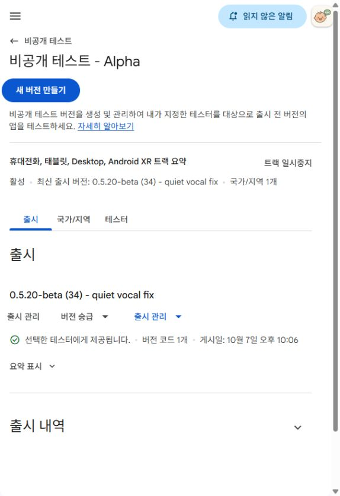
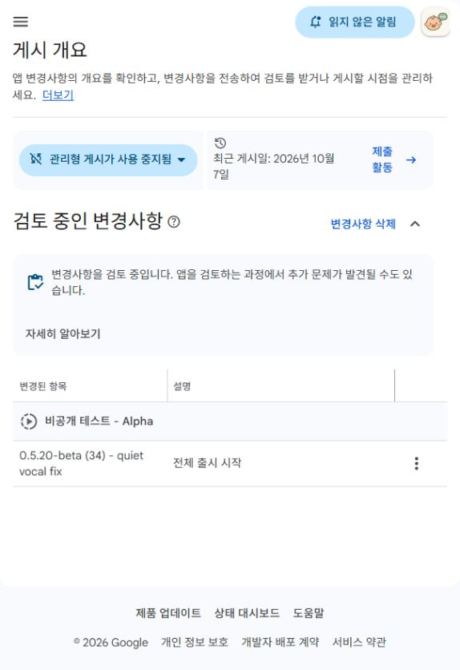
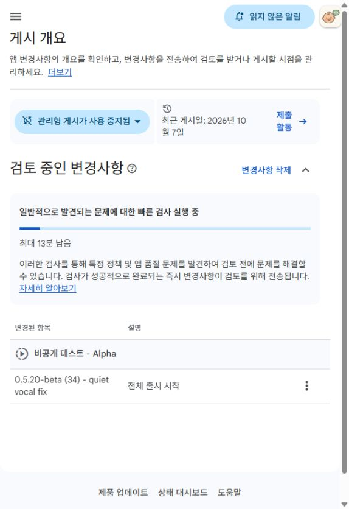

# beta34 Alpha 검토 요청 증거

## 최신 — code34 선택테스터 제공 확인

2026-10-07 22:14:12 KST Alpha의 최신출시가 `0.5.20-beta (34) - quiet vocal fix`이고
**선택한 테스터에게 제공됩니다**를 확인했다. Console 게시일은 **10월7일 오후10:06**이다.
게시 개요의 검토 항목이 해소되고 앱업데이트 게시 알림도 표시됐다.
실제 version34의 Alpha 상태를 판정 근거로 사용한다.

테스터 탭에서 Zardu33명·기존그룹회원4명·원래비공개2명 모두 선택됨을 읽었다.
이 수치는 겹칠 수 있으며 고유인원으로 합하지 않는다. 설정을 변경하지 않았다.
원 DOM은 work 범위의 `play/code34-available.txt`, `play/code34-testers.txt`에 보존한다.

- 설치/업데이트: https://play.google.com/store/apps/details?id=com.moa.babylanguage
- 웹 참여: https://play.google.com/apps/testing/com.moa.babylanguage

사용자가“테스터가 다 깔았대”라고전달했다. 업체설치완료의사용자전달로기록하며,
개별테스터의설치버전·opt-in시작일·연속14일은직접검증하지않았다.
승인 확인 목적은 달성됐으며 증거푸시후 자동화33을 일시중지한다.

아래는 게시 전의 검토 이력이다.

## 최신 — 사전 검사 종료, Google 검토 중

2026-10-07 21:38:17 KST: 사전 검사 진행 표시가 사라지고 `변경사항을 검토 중입니다`로
바뀌었다. 정확한 code34는 `검토 중인 변경사항`에 계속 표시된다. 실제 제공은 아직 미확인이다.

아래는 앞선 요청 접수 시점의 기록이다.

- 확인 시각: 2026-10-07 21:25:49 KST.
- 대상: 아가톡 - 지금 내 기분이 그래 / `com.moa.babylanguage` / 기존 Alpha.
- 출시명: `0.5.20-beta (34) - quiet vocal fix`.
- 검토 요청: 출시 저장 → 게시 개요 변경1건 → 검토 전송 확인 → 실제 상태 확인.
- 게시 개요: **검토 중인 변경사항**, 사전 빠른 검사 실행 중.
- 정확한34가 요청에 포함됐으나 승인·테스터 제공은 아직 확인하지 않았다.
- 마지막 제공 확인 버전: code33. 기존 세 테스터 목록·그룹을 변경하지 않았다.

## 제출물

`Agattok-0.5.20-beta-code34.aab`, 160195341B.

SHA256: `172df8f28cd2ac503bbb7b6e4c4c4f34a9df18b349549b4ee75313addbd0ec25`.

Play에서34 / 0.5.20-beta / min26 / target36 / 4 ABI를 확인했다.
지원기기 감소0. 참조 기기 신규설치112MB, 이전 대비1.32KB.
가독화 파일·native 디버그 기호 권고2개이며 제출차단오류는0이다.
beta AAB 한 개만 올렸으며 비교 release AAB는 업로드하지 않았다.

출시 노트: “작게 담긴 옹알이를 인식한 뒤에도 ‘너무 조용해요’로 결과가
보류되던 일부 경우를 개선했어요.”

## 화면

원 DOM과 화면은 `work/accepted-vocal-audibility-20261007/play/`에도 보존했다.
이 화면으로 실제 업체 로그인·설치·12명 연속14일 참여를 입증하지 않는다.

## 남은 확인

기존 자동화33을 code34 승인 확인으로 갱신했다. 15분 주기, 상태가 같으면 조용히 종료한다.
정확한34의 Alpha `선택한 테스터에게 제공됩니다` 확인 → 작은 화면 증거 →
QA/HANDOFF/NEXT/summary 갱신 및 커밋·푸시·SHA 대조 → 자동화 일시중지 → 전체 목표 감사.
중복 업로드·기존 제출 취소·다른 트랙/프로덕션/상품/권한 변경은 하지 않는다.
