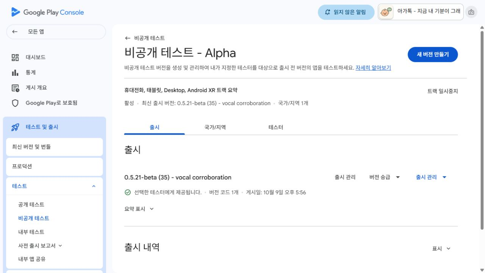
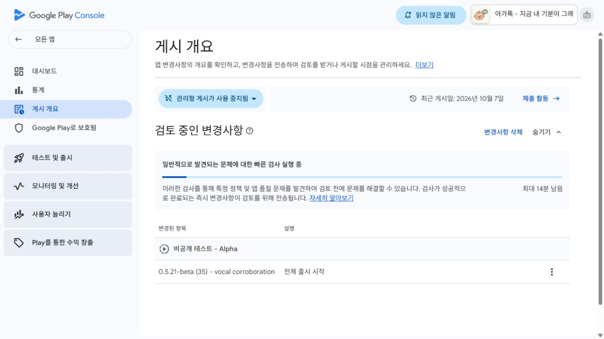

# Alpha code35 게시 확인 — 2026-10-09

## 게시 확인

- **18:13 KST 확인:** Alpha가 활성 상태이며 최신 출시 버전은 정확히
  `0.5.21-beta (35) - vocal corroboration`이다. 출시 ID15.
- **선택한 테스터에게 제공됩니다. 버전 코드 1개 게시일: 10월 9일 오후 5:56**을 확인했다.
- 게시 개요의 검토 중 변경사항은 해소됐고 최근 게시일은2026년10월9일이다.
  관리형 게시 사용 중지 상태가 유지됐다.
- 게시 증거 `ba80920b7bce26649ea1620e2be6e70136043d14`를 푸시하고 로컬/원격 SHA 일치와
  clean을 확인했다. 이후 기존 승인 확인 자동화33을 도구로 **PAUSED**로 갱신했다.
- 새로운 업로드·설정 변경·기기 검사는 수행하지 않았다. 실제 업체 계정별 설치/업데이트,
  최소12명의 연속14일 참여를 검증한 것은 아니다.
- 후속200ms 시각 관찰 후보는 미배포다. 이번35의 시각 관찰 간격은500ms다.

[Alpha 원시 UI](play-available.txt), [게시 개요 원시 UI](play-published-overview.txt),
[게시 개요 화면](play-published-overview.png).

### 완료 범위 감사

code35의 로컬 QA·최종 패키지 검증·Alpha 제출·실제 제공 확인·증거 푸시는 완료됐다.
새 빌드/ADB/중복 업로드는 필요 없어 실행하지 않았다. 전체 목표는 완료 처리하지 않는다.
남은 요건은200ms 후보의 실폰 성능 측정과 다음 버전 패키징, 음성 보류와 시각 시간축의
연결 개선, 실제 실패 입력 재현과 더 넓은 독립 자료 검증이다. 일반 인식/욕구 정확도는 미입증이다.

## 17:20 검토 요청 이력

- **17:20 KST:** 기존 Alpha의 `0.5.21-beta (35) - vocal corroboration` 한 건을 검토 요청했다.
- 게시 개요의 **검토 중인 변경사항**에 정확한 버전이 표시된다.
- 사전 빠른 검사가 진행 중이며, 성공하면 Google 검토로 넘어간다는 안내다.
- **테스터에게 제공되는35를 아직 확인하지 않았다.** 마지막 실제 제공 확인은34다.
- 관리형 게시 사용 중지 상태는 그대로다. 다른 트랙/상품/테스터 목록을 변경하지 않았다.

출시 초안/검토 ID는15다. 검토한 AAB는
`work/corroborated-vocal-20261009/final/Agattok-0.5.21-beta-code35.aab`이며,
SHA256 `6608e17f827c193df3a82a6b3eaa595467ba880037d40fb343877444fc36cd13`를 업로드 직전 재확인했다.
release 비교용 AAB나 이전 버전 추가 업로드는 하지 않았다.

## Google 사전 검증

- 제출 차단 오류0, 경고2: 가독화 파일 없음 / native debug symbols 없음.
  이전에도 있던 진단 파일 권고이며 이를 해결했다고 주장하지 않는다.
- 지원 기기 감소0: 전화11,321, 태블릿6,439 등 기존 지원 수 유지.
- Console 설치 크기112MB, 이전 대비1.92KB 증가. 별도 대형 모델 추가 없음.
- 버전35/0.5.21-beta, API26+, target36을 확인했다.
- beta QA와 package hash 검증 이후 코드/QA `86cbd14`를 푸시하고
  로컬/원격SHA 일치·clean을 확인한 뒤 제출했다.

원시 UI 텍스트는 [검증 화면](play-preflight.txt), [제출 화면](play-submitted.txt)에 보존한다.
트랙 출시 화면의 설치 수 표시를 실제 테스터 참여 인원으로 해석하지 않았다.
이번 작업은 실제 테스터 설치나12명 연속14일을 새로 검증한 것이 아니다.

## 당시 승인 확인 계획

기존 자동화33을 **아가톡 0.5.21 승인 확인**, ACTIVE/15분으로 갱신했다.
변화가 없으면 조용히 종료하며 승인·반려·오류·사용자 조치가 있을 때만 알린다.
정확한35의 `선택한 테스터에게 제공됩니다`를 확인한 뒤 배포 증거와 문서를
커밋·푸시·SHA/clean 대조하고 자동화를 일시중지한다. 중복 업로드나 제출 취소는 하지 않는다.

- [설치/업데이트](https://play.google.com/store/apps/details?id=com.moa.babylanguage)
- [테스터 참여](https://play.google.com/apps/testing/com.moa.babylanguage)
