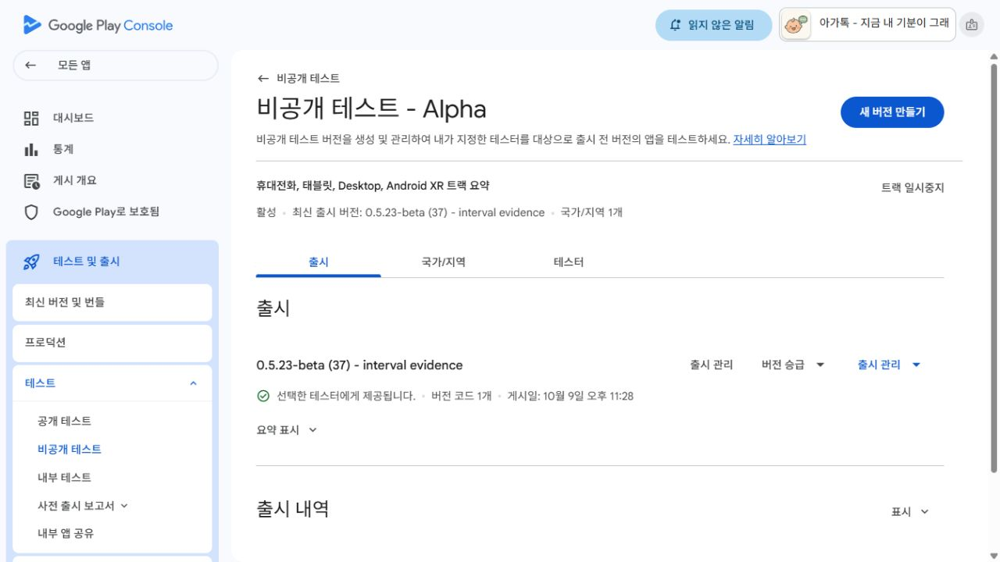

# 0.5.23-beta(code37) Alpha 제공 확인

## 확인한 상태

- 제공 확인: **2026-10-09 23:32 KST**. 검토 요청 확인은22:01 KST.
- 기존 비공개 테스트 **Alpha**, 출시ID17.
- 이름: `0.5.23-beta (37) - interval evidence`.
- Alpha: 정확37에 **선택한 테스터에게 제공됩니다** 표시.
- Console 게시일: **2026-10-09 23:28 KST**.
- 게시 개요: 검토 중인 변경사항이 해소됨. 별도 게시 조치 없음.
- 관리형 게시: 사용 중지.
- 현재 확인된 테스터 제공 버전: **0.5.23-beta(37)**.
- 자동화33: 제공 증거 커밋·푸시·SHA/clean 확인 후 일시중지 예정.

## 제출한 파일과 사전 검증

- `work/interval-evidence-20261009/final/Agattok-0.5.23-beta-code37.aab`.
- 160,200,230바이트.
- SHA256 `d27dc2601626a81cf1f2f4ff3aa0bc33ac7a4e706c050a7c9a1e888aaab14372`.
- 앱 소스46d7a74 / 버전1399f64 / QA 기록15dcd85. 업로드 전원격 SHA 일치·clean 확인.
- 지원 기기 감소: 전 폼팩터0. 전화11,321 / 태블릿6,439 유지.
- 신규 설치112MB, 이전 대비3.63KB 증가. 예상 업데이트2.56MB.
- 제출 차단 오류0. 기존 가독화 파일/네이티브 디버그 기호 권고2개.
  R8을 켜서 권고만 없애는 변경은 이번검증에 포함하지 않았다.
- 실제36→37 구형기록·MP4 해시 보존, beta37 분석/저장/MP4,
  같은 서명의 정식release37 시각/PDF/60·10 재잠금까지 통과.
  release37 비교 AAB는 Play에 제출하지 않았다.

## 범위와 다음 확인

사용자가 승인한 기존 Alpha 업데이트 한 건만 전송했다. 기존 세 테스터 목록·그룹,
다른 트랙·프로덕션·상품·권한은 변경하지 않았다. 아기 자료 외부 전송과 업체 메시지는 없다.
업체 계정별 실제 설치나12명 연속14일의 조건을 새로 검증한 것이 아니다.

37은 구간 일부의 발성단서와 넓은 시간범위의 영상관찰 연결을 보완한다.
일반 인식률·감정/욕구·화자 확인이나 새 S25 성능을 입증한 것은 아니다.
Alpha의 정확37 제공과 게시개요 검토 항목 해소를 확인해 아래 작은 증거를 보존했다.
문서·요약을 커밋/푸시해 local/remote SHA·clean을 대조한 뒤 자동화33을 일시중지한다.
이번 배포 완료가 장기 인식·욕구 해석 목표 완료를 뜻하지 않는다. 정리 정책 차단3곳도 유지한다.

기존 설치: https://play.google.com/store/apps/details?id=com.moa.babylanguage

웹 참여: https://play.google.com/apps/testing/com.moa.babylanguage

## 증거

- [Alpha 제공 텍스트](play-available.txt)
- [Alpha 제공 화면](play-available.png)
- [게시개요 대기 항목 해소](play-publishing-cleared.txt)
- [출시검증 텍스트](play-pre-submit.txt)
- [제출후 텍스트](play-submitted.txt)
- [제출후 화면](play-submitted.png)

