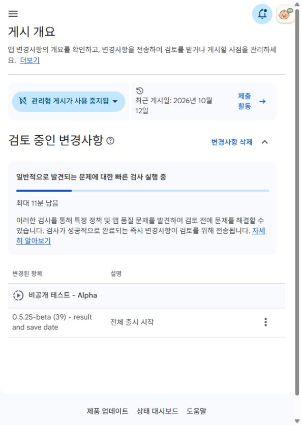
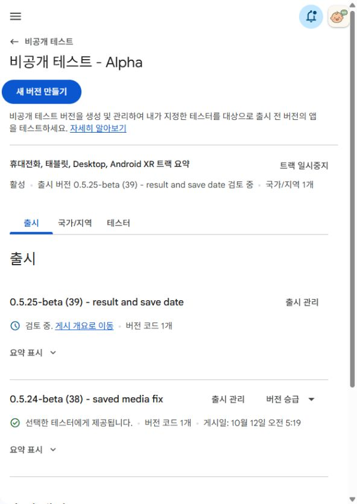

# Alpha39 검토 요청 — 2026-10-12

## 확인 상태

- 기존 Alpha / 출시19 / `0.5.25-beta (39) - result and save date`.
- 정확 beta AAB 업로드·저장 후 변경사항1개 전송 확인을 눌렀다.
- **2026-10-12 23:36 KST** 게시 개요에서 정확39가 **검토 중인 변경사항**으로 이동한 것을 확인했다.
- 사전 빠른 검사 진행 중이며 화면은 검사 성공 후 검토로 전송된다고 안내한다.
- Alpha도 정확39 **검토 중**을 표시한다. **38은 선택한 테스터에게 제공됩니다**로 남아 있다.
- 관리형 게시 사용 중지. 승인 후 자동 게시 예정이지만 **39 실제 제공 완료는 아직 미확인**이다.
- 사용자가 예약을 금지했으므로 자동화33 PAUSED를 유지하고 새 확인 예약을 만들지 않았다.

## 제출 파일과 검증

- 파일: `work/result-scene-20261012/final/Agattok-0.5.25-beta-code39.aab`
- SHA256: `b77b5d3cf31164031ed3a90a9a73b66e90fbd80954f482925e8faec8ee360fb0`
- 사전 제품/패키지/서명/기존 기록·MP4 보존/정식 재잠금 검증 완료. 검증 근거 커밋 `ad35dad2713ec0ca509320f569f26fa0f1c8804b`는 제출 전에 푸시하고 로컬/원격 일치·clean을 확인했다.
- Play 오류0, 권고2(난독화 해제 파일·native debug symbols). R8은 기존 설정대로 비활성이다.
- 지원기기 감소0/추가0. 휴대전화11,321·태블릿6,439. 신규 설치112MB(+13.2KB), 업데이트5.99MB.
- 기존 Alpha 선택 테스터 대상 전체 출시다. 다른 트랙·프로덕션·테스터목록/그룹·상품·권한 변경 없음.
- 연구/정식 비교용 파일은 제출하지 않았다. 실제 테스터 설치/12명14일 확인을 대신하지 않는다.

## 화면 근거

[게시 개요 접근성 텍스트](play-review-submitted.txt)

[Alpha 접근성 텍스트](play-alpha-review.txt)

## 다음 수동 확인

정확39에 ‘선택한 테스터에게 제공됩니다’가 표시되면 제공 시각과 화면을 기록한다.
현재 외부 Google 검토/게시가 남아 있으며 새 빌드·폰 검사·재업로드는 필요하지 않다.

- 설치/업데이트: https://play.google.com/store/apps/details?id=com.moa.babylanguage
- 웹 참여: https://play.google.com/apps/testing/com.moa.babylanguage
