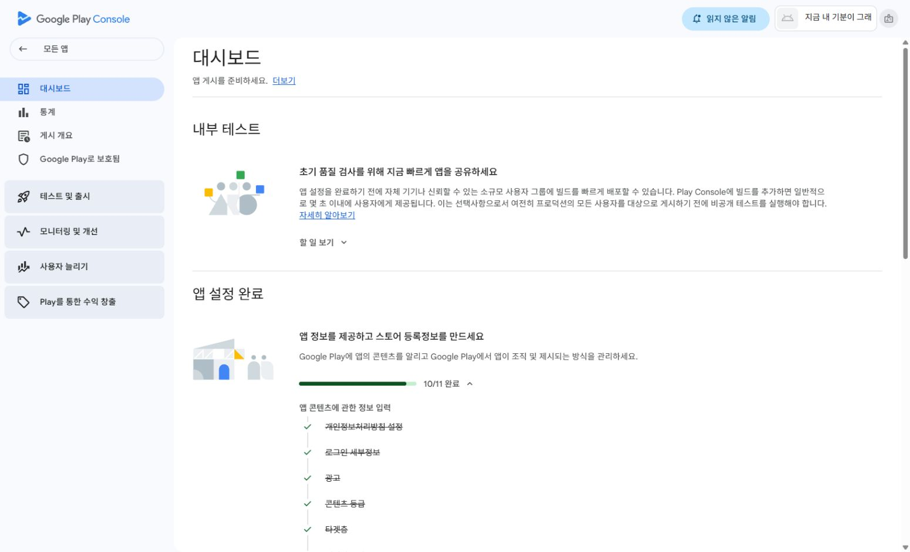
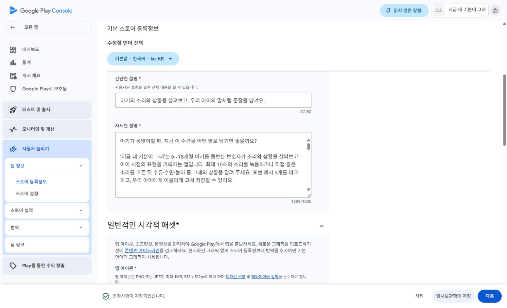
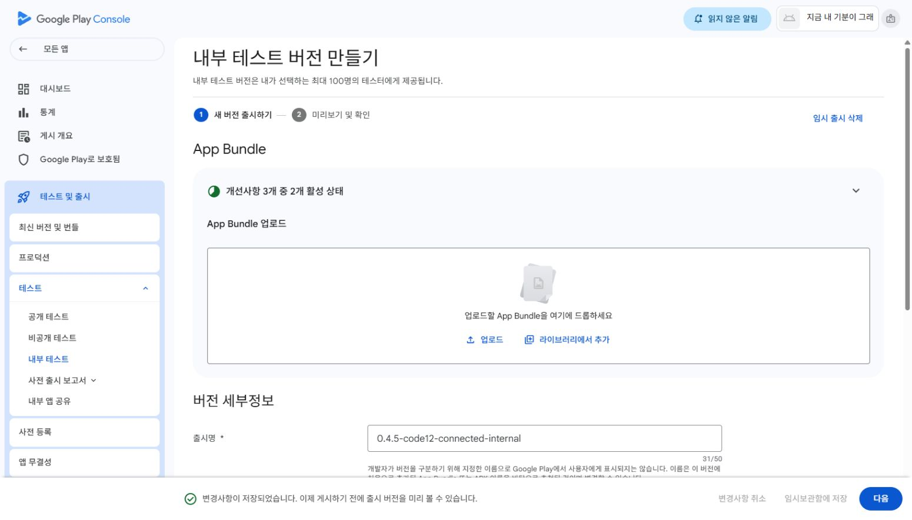

# 상품 등록을 제외한 Console 후속 준비

2026-10-01 · Android 소스/SDK/모델/APK/AAB와 서버 배포를 변경하지 않았다.

## 실제 완료한 작업

1. 최종 연결 후보의 데이터 흐름으로 Data safety를 작성하고 저장했다. 저장 성공 메시지와 대시보드 **10/11**을 확인했다. [응답 근거](DATA-SAFETY.md).
2. 기존 최종 한국어 제목·간단한 설명37자·전체 설명1393자를 스토어 임시보관함에 저장했다. 이미지 6개는 아직 업로드하지 않았다.
3. 내부 테스트 `releases/1` 초안을 만들고 `0.4.5-code12-connected-internal` 이름과 한국어 안내를 임시보관함에 저장했다. AAB는 아직 추가하지 않았고 테스트 트랙은 비활성이다.
4. 운영자 개인 테스트 안내를 저장소 밖에 준비했다. 서버 서명 확인으로 구매 없이 카메라·영상·PDF를 사용할 수 있으며 테스트 종료 후 각 기기에서 해제한다. [운영자 안내](../../OWNER-TEST.md).
5. 해당 코드의 현재 서명 왕복을 포함한 HTTPS9/9을 확인했다. 앱 구매 대역·실제 거래·새 ARM 시험이 아니다. [서버 점검](owner-test-preflight.json).
6. 업로드 예정9개 기존 소재/설명 파일의 해시·크기/모드를 기존 manifest와 비교해 모두 불변임을 확인했다. [소재 근거](store-upload-preflight.json). 휴대폰 화면은 실제1:2 캡처이며 실제 Console 업로드 검사를 통과했다고 보고하지 않는다.
7. 같은 버전·크기의 중간 configured APK/AAB/서명로그3개를 로컬 보관 폴더로 옮겼다. 이동 전후 해시와 최종 connected APK 불변을 확인했다. [이동 근거](intermediate-artifact-archive.json).

## 기다리는 단계와 제외한 범위

- 브라우저 업로드 규칙에 따라 **이 앱의 내부 테스트 초안에 최종 AAB + 스토어 아이콘·피처·실제 화면4장 업로드**를 구체적으로 묻고 응답을 기다린다. '전체 작업' 요청을 별도의 업로드 확인 답변으로 임의 해석하지 않았다. 최종AAB SHA는 [기존 연결 산출물](../../qa/0.4.5/connected/artifacts.json)을 따른다.
- 상품 등록과 이에 의존하는 실제 구매·ACK/환불은 사용자의 최신 진행 범위에서 제외했다. 유료 공개 출시의 필수 조건은 그대로 남는다.
- 은행 소액 인증 금액, 물리 ARM/OEM 기기, 실제 보호자 피드백, 테스터 모집과12명14일은 현재 완료할 수 없거나 자료/기기/시간이 필요한 범위다. ADB 연결 기기는 없었다.
- 공개 출시 검토 전송·테스트 배포 시작·일반 테스터 초대·YouTube 트레일러 업로드를 실행하지 않았다. 트레일러 확정 MP4는 유지한다.

데이터 보안 CSV 내려받기 시도는 다운로드 대기 도중 도구의 실행 기한이 초과돼 끝내지 못했다. CSV 파일을 확보했다고 보고하지 않는다. 이후 저장된 대시보드10/11로 설문 저장 자체는 확인했다. 실패 후 같은 업로드/초안을 중복 생성하지 않았다.
