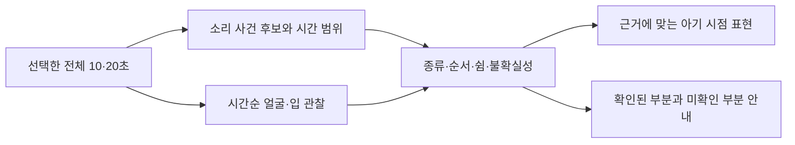

# 아가톡 인식·구간·표현 개선 조사 — 2026-10-12

사용자 요청: 기존 업데이트를 제공하고, 여러 사이트의 논문·엔진·모델을 조사해 개선점을 찾는다.
기준 소스: `6f66b065483f24ea2003b877ae35ef236675bbc7`, 배포 후보 **0.5.25-beta / code39**.
이번 문서는 공개 원문 조사와 현재 소스 대조다. 새 모델 실행·학습·제품 연결 결과가 아니다.

## 결론과 우선순위

**(추천) 현재 누락이 어느 단계에서 생기는지 기록하고, 기존 시간축 모델 후보를 같은 사건 단위로 비교한 다음, 확인된 사건 순서를 문장에 연결한다.**
소리 존재·소리 종류·발성 주체·욕구를 각각 검증해야 한다. 모델 이름이나 한 번의 좋은 출력으로 네 단계를 한꺼번에 해결했다고 판단할 수 없다.

1. **P0 — 누락 원인과 반복 표현을 계측한다.** 디코딩 실패, 발성 미검출, 종류 충돌, 시각 관찰 불충분, 같은 표현 후보 선택을 구분한다.
2. **P1 — 짧은 발성의 시간 구간을 회복한다.** 현재 YAMNet+AST를 기준으로 이미 이식 검증한 EfficientSED를 비교한다. 새 아기 자료에서 추가 회복·오인·실폰 비용을 확인해야 한다.
3. **P2 — 구간 근거를 문장으로 옮긴다.** 관찰된 발성 종류, 순서, 실제 확인된 쉼, 얼굴 관찰 범위를 보존한다. 표현 후보 수 증가만을 인식 개선으로 세지 않는다.
4. **P3 — 영상 속 발성 주체를 연구한다.** Light-ASD/LR-ASD를 작은 연구 후보로 두되, 영아·얼굴 가림·성인 동시 발성과 동기 어긋남 검증을 먼저 한다.
5. **P4 — 실행 엔진을 최적화한다.** 현재 모델의 수치/판정 보존과 전체 분석 비용을 기준으로 CPU/XNNPACK/NPU를 비교한다. 가속을 정확도 향상으로 보고하지 않는다.

상세 원문 조사는 [영아 음성·모델](20261012-infant-audio-survey.md), [Android 엔진·멀티모달](20261012-mobile-inference-survey.md)에 둔다.

## 1. 현재 앱 소스에서 확인한 병목

아래는 공개 논문에서 추정한 결함이 아니라 이번에 현재 worktree의 기호를 직접 읽어 확인한 구조다. 사용자 특정 영상의 실패 원인을 새로 재현한 것은 아니다.

| 현재 구조 | 코드 근거 | 개선 판단 |
|---|---|---|
| 갤러리 선택 구간의 PCM을 읽고 YAMNet 뒤 조건부 AST를 실행한다. 영상 관찰은 그 뒤 진행한다. | `ClipEvidence.kt`, `DeviceClipAnalyzer.analyze` | 모델 총점 외에 decode/primary/support/visual/render 단계별 상태·시간을 남겨야 실제 누락 단계가 드러난다. |
| AST는 최대10초 창을 5초씩 옮긴다. 20초 입력이면 0–10/5–15/10–20초 창이다. | `AstAudioAnalyzer.kt:150`, `windowRanges` | 선택20초가 넓은 창들에 포함되는 것과 짧은 옹알이 시작/끝을 찾는 것은 별도다. AST창을 임의로1초로 바꾸면 같은 학습 조건이 아니므로 기존 짧은창 실패 조사도 따른다. |
| broad AST창은 정확한 `VocalMoment`로 바꾸지 않는다. 부분 관찰 회복은 이미 존재한다. | `SoundTimeline.kt:82`, `decide`; `EvidenceInterpreter.interpret` | 부분 결과 기능을 신규 아이디어로 다시 세지 않는다. 남은 일은 실제 놓친 사건의 위치·소리 종류 근거를 늘리는 것이다. |
| 넓은 창/부분 결과에서는 전체 파형의 bursts/rising 등을 아기 리듬으로 쓰지 않도록 제한한다. | `ClipEvidence.kt:134` 인근 | 이는 성인/배경 소리의 리듬을 아기 것으로 오인하는 것을 막는다. 제한을 없애려면 사건별 음성 근거부터 확보해야 한다. |
| 발성 종류별 기본 표현은 각8개이고 일반 발성도8개다. `wordingKey`로 후보를 결정적으로 고른다. 순서·쉼 표현은 추가 증거를 요구한다. | `BabyExpression.kt:5`, `variants`, `pausedPhrase`, `orderedPhrase`; `ClipEvidence.kt:143` | 서로 다른 영상도 같은 종류·제한된 관찰로 묶이면 유사 문장이 나올 수 있다. 이 구조만으로 이전 결과가 남았다고 단정하지 않는다. |
| 영상 결합은 승인된 소리창과 입 움직임·입꼬리 지속 등을 제한적으로 연결한다. 부분 결과/여러 얼굴 등의 조건은 제외한다. | `VisualSoundAlignment.kt:14`, `find`; `VisualExpression.combine` | 장면의 모든 상황·주관적 기분을 읽는 구조가 아니다. 소리가 난 사람과 화면 얼굴이 같은지 입증하는 모델도 현재 경로에 없다. |

위 소스는 모두 `outputs/MoaAndroid/app/src/` 아래이며 AST는 `astProbe/java/com/moa/babylanguage`, 나머지는 `main/java/com/moa/babylanguage`에 있다. 코드의 현재 구현과 연구 가설을 구분한다.

### 반복 표현의 평가 기준

- 같은 영상·같은 구간은 같은 근거를 재현해야 한다. 문장만 무작위로 바꾸어 다양해 보이게 만드는 것은 목표가 아니다.
- **관찰 가능한 차이가 있는 영상 쌍**을 미리 정한다. 예: 옹알이→웃음과 웃음→옹알이, 실제 쉼 있음/없음, 발성 있음/없음.
- 두 결과가 해당 차이를 보존하는지 평가한다. 서로 다른 표정만으로 배고픔·졸림 등 다른 원인을 만들어야 한다는 기준은 사용하지 않는다.
- 이전 입력 상태 누수는 별도 회귀 검사다. 이미 수행한 새 입력 초기화 검증을 유지하며, 문장 유사도 자체를 상태 누수 증거로 삼지 않는다.

## 2. 기존 연구 중 그대로 이어갈 것

| 후보/작업 | 이미 확보한 것 | 아직 없는 것 |
|---|---|---|
| EfficientSED `fmn10+tf-256` advanced KD | 공식 파일20,304,913bytes·약5.03M params,447 temporal labels; Kotlin frontend와 Android x86 에뮬레이터 합성7조건의 mel/logit parity·종료후 회복 | 독립된 새 영아 사건 회복, 성인/TV 오인, ARM 전체 분석 시간·발열, 제품 연결 |
| TalkNet | 실제 한10초 영상의 원음/무음/±500ms 비교 | 올바른 정렬이 우수하다는 증거. 기존에는 +500ms 조건이 원음보다 높아 제품 채택을 보류했다. |
| 부분 중립 발성·넓은창 시각 연결 | 제품37/38에 제한된 회복이 이미 포함됨 | 일반 인식률·정확한 사건 경계·발성 주체·욕구 정답 |
| 결과 날짜/뒤로가기/장면 표시39 | S25 검사 및 signed 업데이트·저장 보존 완료 | 새 인식 모델을 도입한 버전이 아님 |

참고: [EfficientSED 비교](20261005-temporal-model-followup.md), [Android parity](20261006-efficientsed-kotlin-frontend.md), [시간계약](20261006-efficientsed-temporal-contract.md), [TalkNet 실제 비교](20261004-talknet-av-comparison.md).
기존 약국/공개 음원을 새 독립 평가 자료로 다시 세거나 합성 수치 검사를 인식률로 바꾸지 않는다.

## 3. 공개 모델·엔진 조사에서 새로 확인한 선택 조건

- **ChildVox**: 영아 발성5종을 분류하는 실제 공개 checkpoint를 확인했다. 하지만 [공식 release](https://github.com/tiantiaf0627/childvox-release/tree/2af22d97d312913fe92d935bffa824d628661deb)와 [모델 카드](https://huggingface.co/tiantiaf/childvox-babblecor-whisper-base/raw/main/README.md)는 상업 사용 금지다. 새로운 모델이 공개됐다는 사실과 앱에 넣을 수 있다는 결론을 분리한다.
- **LittleBeats**: 가족을 나눈 평가가 있는 장점이 있으나 [원문](https://pmc.ncbi.nlm.nih.gov/articles/PMC12875392/)의 대상 범위·겹침 제외·외부 데이터 저음량 선별 때문에 조용한 옹알이/겹침/14–18개월을 그대로 입증하지 않는다. exact weights 권리도 해결 전이다.
- **ORT/XNNPACK**: 이미 쓰는 ONNX 경로를 유지한 비교가 엔진 중 첫 순서다. [공식 문서](https://onnxruntime.ai/docs/execution-providers/Xnnpack-ExecutionProvider.html)의 연산자 제한과 CPU fallback을 확인하고 위임률을 측정한다.
- **QNN**: Android용 plugin artifact가 실제로 공개됐지만 개발 문서의2.7.0 조합과 [Maven의 공개 release2.6.0](https://repo.maven.apache.org/maven2/com/qualcomm/qti/onnxruntime-android-qnn/maven-metadata.xml)이 달랐다. 문서 최신 버전을 현재 앱의 검증된 호환 조합으로 쓰지 않는다.
- **NNAPI**: [Android15부터 deprecated](https://developer.android.com/ndk/guides/neuralnetworks/migration-guide)여서 신규 장기 투자 우선도를 낮춘다. 기존 앱에서 즉시 실행 불가능하다는 뜻은 아니다.
- **LiteRT/ExecuTorch/Gemma3n**: 공식 모바일 경로가 있어도 현재 모델 변환·RAM·동작 비용은 실험이 필요하다. 특히 [Gemma3n](https://ai.google.dev/gemma/docs/gemma-3n)의 effective parameter 표기를 앱 총메모리로 해석하지 않는다. 생성형 문장이 자연스럽다고 영상 근거와 맞는다는 보장은 없다.

라이선스·artifact·SDK별 출처와 세부 제약은 두 상세 조사 메모에 남겼다. 사용자 자료 업로드나 상업 금지 모델의 제품 편입은 실행하지 않았다.

## 4. 이번에 다시 확인한 영상·시간축 원문

### Light-ASD / LR-ASD: 작은 발성 주체 후보

[Light-ASD CVPR2023 원문](https://openaccess.thecvf.com/content/CVPR2023/html/Liao_A_Light_Weight_Model_for_Active_Speaker_Detection_CVPR_2023_paper.html)은 AVA에서 약1.0M parameters/0.6G FLOPs와94.1% mAP를 보고한다. 이는 얼굴별 말하기 여부의 연구 수치다. 영아 발성이나 욕구의 정확도, Android 전체 처리시간을 뜻하지 않는다.

오늘 [공식 Light-ASD 저장소](https://github.com/Junhua-Liao/Light-ASD/tree/ed38c232de5efe0261dbd68627c0ade7cdfe14eb)와 [LICENSE](https://github.com/Junhua-Liao/Light-ASD/blob/ed38c232de5efe0261dbd68627c0ade7cdfe14eb/LICENSE)를 직접 조회했다. repo MIT이며 GitHub 파일 metadata상 `pretrain_AVA_CVPR.model`은4,175,289bytes다. 이름의1.0M은 파라미터 수이고1MB 파일이라는 뜻이 아니다.

후속 [LR-ASD IJCV2025 공식 저장소](https://github.com/Junhua-Liao/LR-ASD/tree/1b6dcd2d8fc2895683de6508ec6294ec47d388ca)도 repo MIT이고 `pretrain_AVA.model`은3,426,337bytes다. README는 AVA validation94.45% mAP를 보고한다. 모델/코드가 실제로 공개된 후보라는 점까지 확인했으며 weight를 내려받거나 실행하지 않았다. 얼굴 검출·추적·crop·음성 특징 추출은 이 파일 크기와 별도 비용이다. 데이터 권리와 weight 재배포 범위의 최종 검토도 별도다.

**판단:** 기존 TalkNet 전체 재실행보다 작은 후속 비교 후보로 가치가 있다. 얼굴과 소리 주체를 확인하는 보조 경로로 연구하고, 검출 실패가 모든 음성 결과를 차단하는 필수 관문으로 바로 넣지 않는다. 옆얼굴/가림/먹기/하품/부모 대화/TV/소리 ±offset 조건을 함께 비교해야 한다.

### LoCoNet: 시간 문맥 설계 참고

[LoCoNet CVPR2024 원문](https://arxiv.org/html/2301.08237)은 같은 사람의 긴 시간 문맥과 여러 사람의 짧은 상호작용을 연결한다. AVA95.2%와 Ego4D68.4% mAP라는 서로 다른 도메인 결과는 한 benchmark의 숫자를 가정 영상으로 옮길 수 없음을 보여준다. 공식 GitHub metadata의 licenseInfo는 null이었다. 이 응답만으로 권리가 없다고 단정하지 않지만 제품 편입 허가도 확보하지 못했다.

**판단:** 같은 얼굴의 시간순 관찰과 인접 사람/소리의 맥락을 분리하는 설계 근거. 현재 앱에 즉시 추가할 배포 모델로 선정하지 않는다.

[Google AVA 원문](https://research.google/pubs/ava-activespeaker-an-audio-visual-dataset-for-active-speaker-detection/)은 얼굴 track의 말하기 여부·가청 여부를 라벨링한 데이터임을 명시한다. '누가 말하는가'와 '왜 그 소리를 내는가'는 다른 출력 계약이다.

### BabyVLM-V2: 이름으로 용도를 오인하지 않기

[BabyVLM-V2 v2,2026-03-29](https://arxiv.org/abs/2512.10932)는 영아 경험을 본뜬 시각·언어 사전학습 및 공간추론/기억/어휘 등 발달형 benchmark를 다룬다. 아기 촬영 영상에서 옹알이의 욕구를 해독한 성능표가 아니다. 이 논문을 '아기말 번역 완성 엔진' 후보로 선정하지 않는다.

### 짧은 사건을 평가하는 지표

[Ferroni et al., DCASE2020 평가 연구](https://arxiv.org/abs/2010.13648)는 사건 길이와 단일 operating point에 따라 모델 순위가 달라질 수 있고, 교집합 기반PSDS가 비교에 도움을 줄 수 있음을 설명한다. 이번 앱에서는 frame 평균만으로 짧은 옹알이 회복을 평가하지 않고 사건별 검출·경계·오인을 같이 본다. PSDS 자체를 사용자 체감 정확도로 표시하지 않는다.

## 5. 구체적인 다음 실험 계약

아래 수치/절차는 **제안된 실험 설계**다. 이번에 실행한 결과가 아니며 사용자 데이터 수집·서버 전송 동의를 대신하지 않는다.

### A. 단계별 관찰

온디바이스 연구 모드에서 선택 구간의 decode 유효 길이, 모델 실행 coverage, 창별 후보, 보류 이유, 시각 유효 관찰 수, 문장 family/분기, 각 단계 wall time을 구분한다. 출력 문장만 보면 detector 누락과 표현 충돌을 분리할 수 없다.

연구용 메타데이터는 로컬에 둔다. 아기 영상/음성/얼굴 임베딩/파일 URI를 서버 로그나 Git에 기록하지 않는다. 연구 기록은 실제 사용자의 보관 기록과 분리한다.

### B. 비교군과 사건 분리

1. **기준선:** 정확code39 모델/전처리/판정 고정.
2. **시간축 후보:** 기존 pinned EfficientSED 한 개. 처음부터 여러 대형 모델을 동시 설치하지 않는다.
3. 모델의 출력을 보기 전에 영아 발성 있음/없음, 사건 시작/끝, 종류 확실/불확실, 보이는 얼굴/가림, 성인·TV·장난감 겹침을 검수한다. 의견이 갈린 사건은 미확정 층으로 둔다.
4. 같은 아기/가족/녹음세션/원본의 파생 clip을 calibration/test에 나누지 않는다. 개발에 쓴 약국 영상은 회귀군으로만 남긴다.
5. 짧은 발성, 조용한 발성, 잡음 동반, 울음/웃음, 말소리 유사 장난감, 아기 흉내, TV 속 아기 음성, 무음, 여러 사람을 나누어 집계한다. TV 속 아기 소리를 실제 아기 없는 일반 환경음과 섞어 라벨링하지 않는다.
6. 10초 경계·선택 끝·padding 구간을 따로 본다. 같은 원본을 이동한 파생 조건은 독립 아기 표본으로 세지 않는다.

### C. 합격 판단에 필요한 결과표

| 지표 | 분모/의미 | 왜 필요한가 |
|---|---|---|
| 처리 성공 | 정상적으로 읽을 수 있는 입력 중 decode/추론 완료 | 파일 문제와 인식 문제를 분리 |
| 발성 검출 재현율 | 검수된 실제 영아 사건 중 찾은 사건 | 출력이 안 나오는 문제를 직접 측정 |
| 오인 비용 | 비영아 장면 수와 총 노출시간당 영아 오인 | 결과를 억지로 늘리는 문제 방지 |
| 근거 있는 결과 제공률 | 실제 영아 입력 중 종류 확정/제한 관찰을 제공한 비율 | 종류 불확실로 전부 실패하는 비율을 추적 |
| 시간 구간 품질 | 사건 교집합 및 onset/offset 오차, 짧은 사건 별도 | 넓은10초창 점수를 정밀 경계로 오인하지 않음 |
| 표현 일치 | 미리 정한 다른 사건쌍의 순서·쉼·종류 차이를 보존 | 문장 다양성과 인식 개선을 구분 |
| 실기기 비용 | cold/warm/연속 사용의 전체시간 p50/p95, peak PSS, thermal, 취소 회복 | PC 추론시간으로 휴대폰 사용성을 대신하지 않음 |

기존 승인 사례·날짜/저장/뒤로가기·권한 재잠금 회귀를 유지해야 한다. 검출 증가와 오인 증가를 한 점수로 숨기지 않는다. 최소한 source별 paired 결과와 가족/세션 기준 불확실성을 제시하고, 독립 자료가 부족하면 파일럿 결과로만 보고한다. 사후에 좋은 threshold와 좋은 사례만 골라 일반 정확도라고 발표하지 않는다.

### D. 문장 연결 방식

이는 제안된 정보 흐름이다. 새 구현 완료 표시가 아니다. 원인/의도가 미확정이어도 확인된 소리·장면 관찰은 전달할 수 있어야 한다. 결과 문장 옆의 근거가 문장과 다른 상황을 말하지 않는지 검사한다.

## 6. 배포·이번 조사 경계

- code39는 날짜·뒤로가기·결과 미리보기/유지 수정판이며 인식 엔진 교체판이 아니다.
- 조사 시작 시 Play39는 검토 중, 제공 확인38이었다. 실제 마지막 상태는 [배포 기록](../qa/result-scene-20261012/delivery/play-review.md)을 따른다.
- 이번에는 원문·공식 GitHub metadata·논문·SDK 문서를 읽었다. 새 model binary·논문용 데이터셋·아기 자료 다운로드/업로드, 폰 점유, 새로운 build/ADB는 하지 않았다.
- 새로운 자동 확인 예약을 만들지 않았다. 장기 개선 목표 완료로 기록하지 않는다.
- Agent Reach1.5.0의 update check는 최신으로 응답했다. Exa 일부 호출 한도 후 검색 connector/공식 GitHub/공개 Jina 읽기를 사용했다.
