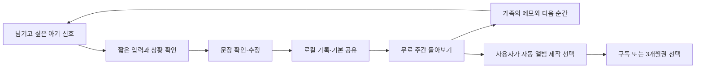

# 지금 내 기분이 그래 — BM·리텐션·가격 실행안

조사일: 2026-09-30 · 대상: 6~18개월 아기의 보호자 · 한국 Android 우선

> **2026-10-06 읽기 안내:** 아래0.4.0의 직접입력·3후보·시간/파일한도·표지 수는 과거 이력이다.
> 현재 기능 경계는 [최신 이용 정책](Jigeum-Access-Policy.md), 개발 현황은 [HANDOFF](../docs/HANDOFF.md)를 따른다.
> 추가 [리뷰·반복 가치 조사](../docs/research/20261006-competitor-review-opportunities.md)와
> [품질·성장 실행 결정](../docs/research/20261006-product-quality-and-growth-decision.md)을 읽는다.
> 아래 가격은 검증 가설이며 상품 등록/실거래로 확정된 가격이 아니다.

**최신 0.4.0 정책:** [무료·전체 이용권 정책](Jigeum-Access-Policy.md)의 권한 분리를 소스에 반영했다. 무료는 10초 녹음/직접 입력과 같은 품질의 3개 문장 후보·수정·저장, 기존 기록, 기본 공유·백업·요약이다. 유료는 **카메라 관찰 + 저장 영상 분석 + 월별 PDF/세 표지**를 모두 여는 하나의 전체 이용권이다. 앨범 미리보기는 무료다. **로컬 통합 빌드·QA를 완료했으며 실제 Play·ARM 검증은 별도**이며 결과는 [0.4.0 QA 보고서](Jigeum-QA-0.4.0.md)에 기록한다. 실제 Play 연결·가격 설정·구매 검증 완료나 출시를 뜻하지 않는다. 아래 시장 조사 수치와 비용 계산은 조사 당시 근거·가설로 유지한다.

**저장 정책:** 사용자 지시에 따라 기록·메모는 온디바이스에만 저장한다. 외부 DB, 계정, 가족 자동 동기화, 원격 행동 계측을 기본 로드맵에서 제외한다. 공유는 사용자가 고른 파일을 직접 내보내는 방식이다. 현재 구현과 레퍼런스 연결은 [온디바이스 구조·엔진 사용 현황](Jigeum-OnDevice-Architecture.md)을 참조한다.

## 1. 현재 결정과 가격 제안

**완성된 무료 경험 + 하나의 전체 이용권**으로 간다. 월 4,900원 자동 갱신과 3개월 12,900원 선불·자동 갱신 없음을 가격 검증안으로 둔다. 실제 앱에는 Play가 반환한 실제 가격과 기간만 표시한다. 연간·주간·평생권과 자동 결제로 전환되는 무료 체험은 현재 범위에 없다.

무료 사용자는 **녹음 또는 직접 입력 → 표현 후보 3개 → 수정 → 저장·기본 공유**를 횟수 차감 없이 끝까지 이용한다. 카메라 관찰, 30초·50MB 이하 저장 영상 분석, 월별 PDF·세 표지는 전체 이용권으로 이용한다. 유료가 문장이나 의도 분석의 정확도를 높인다고 약속하지 않는다. 월별 앨범 미리보기와 기록 보존·백업은 무료다.

표현은 조합별 16개 문장에서 최근 제시한 9개를 피하는 유한한 구성이다. 무한한 새 문장이나 마음을 학습하는 기능으로 구독 가치를 설명하지 않는다. 가격 검증은 관찰 입력의 편의와 실제로 남기는 결과물의 가치에 대해 진행한다. 0.4.0은 확정 정책을 코드에 반영하고 통합 검증하는 단계이며 실제 Play 구매가 연결돼 검증된 상태라고 표현하지 않는다.

## 2. 용어와 조사에서 확인한 점

- **하드 페이월:** 핵심 기능에 접근하기 위해 먼저 결제나 자동 결제로 전환되는 체험 등록이 필요한 구조.
- **프리미엄 기능 결제:** 기본 기능을 계속 무료로 쓰면서 추가 기능을 선택할 때 결제하는 구조. 이 앱의 권고 방향이다.
- **사용 리텐션:** 처음 가치를 경험한 가구가 이후 주에도 유의미한 활동을 하는 비율.
- **유료 리텐션:** 결제한 가구의 구독 권한이 유료 갱신을 거쳐 유지되는 비율. 접속률과 별도로 측정한다.

### 구독 벤치마크

RevenueCat의 **State of Subscription Apps 2026**은 주로 2025년 데이터를 분석하며, RevenueCat을 쓰고 최소 설치/수익 조건을 충족한 115,000개 이상의 앱을 포함한다.[1]

| 지표 | 하드 페이월 | 프리미엄 무료 모델 | 해석 |
|---|---:|---:|---|
| 설치 후 35일 안에 유료 구독한 비율의 중앙값 | 10.7% | 2.1% | 초기 결제 전환 차이는 큼 |
| 연간 구독자의 1년 유지율 중앙값 | 27% | 28% | 장기 유지에 큰 차이가 관측되지 않음 |
| 월간 구독자의 1년 유지율 중앙값 | 9% | 8% | 월 구독은 첫 갱신 전에 반복 가치를 보여 주는 것이 중요 |

이것은 같은 앱에 페이월만 바꾼 무작위 실험이 아니다. 카테고리·고객 의도·유입 채널·가격이 다르고, 한국 부모 앱의 대표 표본도 아니다. **우리 앱의 예상 전환율이나 하드 페이월의 인과 효과로 쓰지 않는다.** 무료 핵심 경험을 유지한다는 사용자 방향, 아직 검증 전인 해석 가치, 가족 공유의 유입 효과를 고려해 무료 모델을 선택한다. 단기 수익 전환이 더 느릴 수 있다는 비용도 인정한다.

### 경쟁 제품의 실제 무료·유료 경계

가격은 확인한 공식 페이지의 통화·청구 방식을 그대로 적었다. 한국 Android 인앱 가격으로 환산하거나 대체하지 않았다.

| 제품 / 확인 페이지 | 무료에서 제공하는 가치 | 확인한 유료 가격·내용 | 적용할 판단 |
|---|---|---|---|
| Huckleberry [2][3] | 기본 기록·리포트, 여러 보호자의 기기 동기화 | 공식 연간 결제 화면의 월 환산 Plus US$5.74, Premium US$9.99. 예측·향상된 리포트·개별 수면 계획 등 | 기본 기록과 부모 공유만으로 구독 차별성을 만들기 어려움 |
| FamilyAlbum [4][5] | 가족 사진/영상 공유, 무료 무제한 저장 안내 | One US$2.99/월, Family US$5.99/월 또는 US$59/년, Family Pro US$10.99/월 또는 US$109/년. 자동 영상·편집·정리 등 확장 | 자동으로 만들어지는 결과물과 편의가 과금 근거가 될 수 있음 |
| 바뱌 [6] | 공식 사이트는 하루 무료 3회 안내 | 한국 스토어의 현재 구독 가격을 이번 조사에서 확인하지 못함 | 횟수 제한 사례는 참고하되 우리 핵심 흐름에 복제하지 않음 |
| MeowTalk [7] | 소리 → 자연어 의미 후보라는 즉각적인 경험 | 공식 사이트의 제품 흐름 확인. 연결된 스토어 페이지는 조회 시 404여서 현재 가격 미확인 | 짧은 첫 경험은 참고. 동물 의미 추정 주장을 영아 성능 근거로 가져오지 않음 |

FamilyAlbum의 유료 기능 페이지에는 구독 종료 후에도 이미 올린 긴 영상을 볼 수 있다는 설명이 있다.[5] 우리의 기존 로컬 기록·내려받은 결과물을 해지 후에도 유지하는 원칙과 맞는다. 경쟁사의 가격이나 기능만으로 실제 수익성·전환율을 알 수는 없다.

## 3. 무료/유료 경계

| 경험 | 무료 기본 | 전체 이용권 | 적용 기준 |
|---|---|---|---|
| 최대 10초 녹음·직접 입력 | 이용 횟수 제한 없음 | 동일 | 기기 내 일반 소리 관찰 |
| 문장 후보·수정·저장 | 같은 품질의 후보 3개, 수정·저장 | 동일 | 정확도·문장 일부를 유료로 잠그지 않음 |
| 카메라 관찰 | 선택 시 전체 이용권 안내 | 새 관찰 시작 허용 | 영아 감정·욕구 진단 아님 |
| 저장 영상 분석 | 선택 시 전체 이용권 안내 | 30초·50MB 이하 새 분석 시작 | 한도는 기술상 상한 |
| 로컬 기록·기본 이동/공유 | 기존 기록 조회·삭제, PNG 공유, JSON 백업·복원, CSV 내보내기 | 동일 | 기록 기간 만료 없음. 최대 10,000건은 저장 상한 |
| 주간 기본 요약·앨범 미리보기 | 무료 | 동일 | 미리보기·기본 요약을 저장 제한으로 사용하지 않음 |
| 월별 PDF·세 가지 표지 적용 | 미리보기 무료 | 기기 내 생성 | 최대 300기록·300쪽. 모션 앨범/클라우드 편집 약속 없음 |
| 해지·만료 | 기존 기록·내보낸 결과물·무료 기능 유지 | 만료 후 새 카메라/영상/PDF 작업 차단 | 이미 생성된 문장 초안은 무료 편집·저장, 저장 완료 기록은 무료 조회·공유·삭제·백업 |

구매 권한은 결제한 Google Play 계정 기준이며 다른 가족 계정에 자동 공유되지 않는다. 받은 PNG·PDF는 수신자가 앱을 구매하지 않아도 볼 수 있다. 앱 계정·가족 자동 동기화·실시간 공동 편집은 범위에 없다.

명시적인 환불/권한 철회·검증 거절을 확인하면 유료 진입을 바로 잠근다. 네트워크 장애는 거절과 구분하고 유효한 서명 캐시 안에서만 최대 24시간 오프라인 이용을 허용한다. 오프라인에서 발생한 환불은 즉시 알 수 없어 반영이 지연될 수 있다. 세부 상태 처리는 [이용권 정책](Jigeum-Access-Policy.md)을 따른다.

기기 시간을 되돌려 오프라인 허용이 늘어나지 않도록 실제 경과시간 상한을 함께 검사한다. 재부팅 후에는 온라인 재확인이 필요하다. 무료 기능과 기존 기록은 계속 사용할 수 있다.

### UX에서 지킬 기준

1. 앱 자체 계정을 만들지 않는다. 처음 실행할 때 결제·알림 권한을 한꺼번에 요구하지 않는다. 가족에게 보내기는 파일을 만든 뒤 OS 공유 화면에서 사용자가 대상을 고른다.
2. 결과를 흐리거나, 핵심 문장 일부를 잠그거나, 울고 있는 상황에서 광고 시청을 요구하지 않는다.
3. 기본 기록을 7일/30일 뒤 사라지게 하지 않는다. 데이터 삭제·기본 내보내기를 구독 혜택으로 묶지 않는다.
4. 무료 홈에 잠금 카드나 결제 배너를 반복 배치하지 않는다. 유료 제안은 사용자가 카메라·저장 영상·PDF를 선택한 지점에 둔다. 무료 녹음/직접 입력과 닫기 경로를 유지한다.
5. 부모 순위, 돌봄 점수, '좋은 부모' 등급, 놓친 발달 신호를 암시하는 문구를 쓰지 않는다.

## 4. 우리 앱에 적용한 Hook Model

Nir Eyal의 원래 모델은 Trigger → Action → Variable Reward → Investment를 설명한다.[8] 여기서는 반복 가치를 점검하는 설계 틀로 사용한다. 특정 알림이나 변동 보상이 리텐션을 보장한다는 공식으로 취급하지 않는다.

| 단계 | 실제 사용 장면 | 제품 동작 | 확인할 지표 |
|---|---|---|---|
| 계기 | 아기가 새로운 소리/표정을 보임, 남기고 싶은 순간이 생김 | 사용자가 직접 실행. 주간 돌아보기는 앱 안에서 무료 제공; 알림은 후속 연구안 | 자발적 재방문, 알림 거부/해제 |
| 행동 | 무료 10초 소리/직접 입력 또는 이용권의 짧은 영상 + 실제 상황 확인 | 홈의 주 CTA, 불필요한 프로필 입력 없음. 첫 완결 경험 30초 안팎을 UX 목표로 시험 | 입력→문장 도달률, 중도 이탈, 첫 가치까지 걸린 시간 |
| 보상 | 오늘 장면을 아이 시점의 문장으로 남기고 가족과 함께 봄 | 실제 입력·부모 교정에 근거한 카드. 다음 주에는 다른 실제 기록을 다시 만남 | '기억하고 싶다/상황에 맞다' 평가, 저장·재열람 |
| 투자 | 부모가 문장을 고치고 한 줄 메모를 남김 | '우리 가족이 쓰는 표현'과 기록이 누적되어 다음 정리가 쉬워짐 | 서로 다른 날의 재기록, 교정 문장 재사용, 요약 재열람 |

**변화는 실제 경험에서 나온다.** 동일한 입력에 의미를 무작위로 바꾸거나 더 자극적인 결과를 뽑게 하지 않는다. 현재 후보 순환은 최근 반복을 줄이는 기능이다. 보호자 교정 문장을 다시 제안하는 개인화·아기 욕구 학습은 현재 혜택에 포함하지 않는다.

### 일상 루프와 주간 루프

후속 알림 연구안은 **동의 후 주 1회**, 사용자가 고른 시간에 기록이 있을 때만 보내는 것이다. 야간 알림과 '아기가 기다린다'는 압박 문구는 피한다. 알림을 꺼도 앱의 가치가 완성돼야 한다.

게이미피케이션은 첫 카드·첫 가족 메모처럼 실제 활동을 조용히 축하하는 수준으로 둔다. 연속 출석 리셋·상실 벌점·부모 간 리더보드는 제외한다. 진행 막대가 필요하면 '앨범에 넣을 기록 3개 선택'처럼 실제 완료 가능한 작업에 사용하고, 가짜 완성도를 만들지 않는다.

## 5. 가격 권고와 검증 방법

| 상품 | 제안 가격 — 한국 소비자 표시 총액 | 청구 | 제안 이유 |
|---|---:|---|---|
| 기본 | 무료 | 없음 | 핵심 경험·기본 기록·공유의 완결성 |
| 월간 | **4,900원** | 매월 자동 갱신 | 카메라·영상 입력 편의와 월별 PDF를 함께 여는 시작 가격 |
| 3개월권 | **12,900원** | 1회 결제, 자동 갱신 없음 | 월 환산 4,300원, 월간 3회 대비 약 12.2% 할인. 사용 시기가 짧은 가구에 맞음 |

초기 3,900원/4,900원/5,900원은 인터뷰에서 비교할 후보이며, 권고 출시 검증가는 4,900원이다. 더 싸게 받아야만 구매한다면 가격 인하 전에 자동 결과물의 가치가 충분한지 확인한다. 단순 기록·공유에만 4,900원을 받는 것은 추천하지 않는다.

연간권은 보류한다. 대상 월령을 벗어나는 자연 이탈이 있고, 1년 유지 가정은 현재 검증되지 않았다. 주간 구독과 평생권도 초기 제외한다. 추후 졸업용 단품 아기말북의 구매 의사가 높으면 약 4,900원 단품을 별도 시험하되 월간 구독과 동시에 상품 수를 늘리지는 않는다.

### 결제 화면 예시

> **카메라·영상부터 아기말북까지, 전체 이용권**  
> 실시간 카메라 관찰 · 저장 영상 분석 · 월별 PDF와 세 가지 표지  
> **월 4,900원 제안 / 매월 자동 갱신 — 실제 앱은 Play 가격 표시**  
> **3개월 12,900원 제안 / 한 번 결제 · 자동 갱신 없음 — 실제 앱은 Play 가격 표시**  
> [선택한 이용권으로 시작] [기본 기능 계속 사용]  
> 구매 복원 · 구독 관리 · 이용약관

월 환산 가격보다 실제 결제 총액과 갱신 여부를 눈에 잘 띄게 둔다. 구독 버튼을 눌렀다고 즉시 결제하지 않고 Play 확인 화면으로 연결한다. 처음에는 카드 등록 후 자동 전환되는 체험을 넣지 않는다. 현재 무료 미리보기를 제공하며 별도 PDF 무료 체험이나 새 혜택은 약속하지 않는다.

## 6. 온디바이스 구조의 수익성

Google 공식 문서는 한국을 포함한 해당 시장의 자동 갱신 구독 수수료 15%와 선불 요금제를 설명한다.[9][10] 국가·프로그램·거래 유형·선불 상품의 실제 적용 수수료는 출시 계정에서 확인해야 한다. 모든 거래가 무조건 15%라고 가정해 계약을 확정하지 않는다.

아래는 **견적·실적이 없는 계획용 민감도 계산**이다. 가정: 표시 가격에 부가세 10% 포함, 수수료 15%, 환불 3%, 유료 계정당 월 고객지원·운영 예비비 500원, 사용자 기록용 서버·DB·추론 API 비용 0원, 공통 운영 예산 월 20만원. 500원과 20만원은 실제 지출이 확인되지 않은 예산 가정이며 지원 대응·정책 페이지·시험 기기 유지 등을 위한 여유분이다. 개발 인건비·광고비·초기 개발비·소득세는 제외했다. 무료 사용자 지원도 이 공통 예산에 포함하는 단순화다. 사용자가 늘어 지원 수요가 커지면 예산을 다시 측정해야 한다. 유료 생성형 API나 클라우드 미디어 보관은 포함하지 않는다.

`유료 계정 월 공헌액 = (표시 가격 / 1.1) × 0.85 × 0.97 − 500원`

| 월 가격 | 위 부가세·수수료·환불 가정 반영 금액 | 유료 변동비 차감 뒤 공헌액 | 월간 상품 3회 결제 시 누적 공헌액 |
|---:|---:|---:|---:|
| 3,900원 | 2,923원 | 2,423원 | 7,270원 |
| **4,900원** | **3,673원** | **3,173원** | **9,518원** |
| 5,900원 | 4,422원 | 3,922원 | 11,767원 |

이 누적 금액에서 공통 운영비·고객 획득비가 더 빠진다. 3개월 선불권 12,900원은 같은 가정에서 3개월 총 공헌액 약 **8,169원**, 월 환산 약 **2,723원**이다. 12,900원 전체를 한 달 구독 매출로 보거나 월 4,900원 상품과 같은 수익으로 계산하지 않는다. 실제 정산의 세금/환불 처리 방식과 선택적 결제 검증 API 비용은 도입 시 정산 자료·견적으로 교체한다.

### 월간 활성 설치 1만 건이라면

전원 월간 상품, 결제 계정당 활성 설치 1건이라고 단순화한 정상 상태 비교다. 앱 계정·외부 DB가 없으므로 서로 다른 기기를 한 가구로 자동 중복 제거하지 않는다. 이 표의 '유료 비중'은 활성 설치 중 결제 설치 비중이며, RevenueCat의 **설치 후 35일 전환율과 분모가 다르다.**

| 활성 설치 중 유료 비중 | 결제 계정 | 월 총 결제액 | 무료 기록용 서버비 | 공통 운영비 포함 후 잔액 — 개발 인건비·광고 전 |
|---:|---:|---:|---:|---:|
| 1% | 100 | 49만원 | 0원 | **11.7만원** |
| 3% | 300 | 147만원 | 0원 | **75.2만원** |
| 5% | 500 | 245만원 | 0원 | **138.6만원** |

이 단순 예산을 넘기려면 월간 결제 계정 **64개**가 필요하다(활성 설치 1만 건 가정의 0.64%). 직원 급여와 광고를 포함한 사업 전체 손익분기가 아니다. 비용이 아직 측정되지 않았으므로 출시 뒤 지원 시간·기기 시험 비용·환불·결제 검증 운영비를 대입한다. 온디바이스 앱도 유지보수와 고객지원 비용은 발생한다.

초기 유료 고객 획득비 목표는 가구당 **3,000원 이하**의 검증 가설로 둔다. 설치→유료 전환이 2%라면 허용 설치 광고비는 단순 계산으로 60원에 불과하다. 유료 광고 확장 전에 기본 공유 카드·자발적 파일 공유·실사용 후기의 유입을 검증해야 한다. 이 계산을 광고 시장의 실제 CPI라고 해석하면 안 된다.

## 7. 리텐션과 전환을 측정하는 방법

**핵심 지표:** 한 주에 서로 다른 두 날 이상 기록을 남기고, 과거 기록 또는 주간 요약을 한 번 이상 다시 본 가구 수. 단순 실행 횟수와 오래 머문 시간은 주 지표로 삼지 않는다.

| 지표 | 정의 | 초기 판단 기준 — 업계 평균이 아닌 팀 가설 |
|---|---|---|
| 첫 가치 도달 | 관찰을 시작한 가구 중 문장을 확인하고 수정/저장까지 마친 비율 | 70% 이상 목표 |
| W1 재사용 | 활성화 후 8~14일에 유의미한 활동을 한 가구 / 충분히 14일 관찰한 활성화 가구 | 30% 이상 목표 |
| W4 재사용 | 활성화 후 22~28일에 유의미한 활동을 한 가구 / 충분히 28일 관찰한 활성화 가구 | 20% 이상 목표 |
| 두 번째 월 결제 | 첫 월 결제 후 실제 갱신일이 지난 가구 중 두 번째 결제를 완료한 비율 | 50% 미만이면 광고 확대 보류 |
| 무료 완결성 | 무료 사용자 중 '핵심 목적을 끝까지 달성했다' 4~5점 응답 비율 | 80% 이상 목표 |
| 결제 압박 | '결제 압박을 느꼈다' 4~5점 응답 비율 | 10% 미만 목표 |

신규 진입 월령 6~8/9~12/13~18개월, 유입 채널, 무료/유료를 분리한다. 18개월을 지나 다른 도구로 옮기는 **자연 졸업**과 사용 중 문제로 인한 이탈을 구분한다. 3개월 선불권의 월별 접속을 '월 결제 갱신'으로 집계하지 않는다.

첫 파일럿 50가구에서 위 수치의 정밀한 통계적 우열을 주장하지 않는다. 사용자 인터뷰와 실패 사례를 함께 본다. 최소 수십 건의 실제 결제 갱신 관측 전에는 수익 예측이나 최적 가격을 확정하지 않는다. 전환이 늘어도 무료 완료율·신뢰가 떨어지면 결제 노출 실험을 중단한다.

### 이벤트 설계

활성화: `capture_started → result_viewed → phrase_confirmed → record_saved`  
반복 가치: `record_revisited`, `weekly_summary_viewed`, `card_exported`, `local_backup_exported`  
과금: `premium_feature_requested → offer_viewed → purchase_pending/purchased → entitlement_active`  
갱신: `renewed`, `grace_period`, `on_hold`, `expired`, `refunded`

위 이벤트는 후속 로컬 집계 설계이며 현재 앱에는 분석 SDK·행동 이벤트 자동 전송이 없다. INTERNET 권한과 자체 통신은 결제 확인에 사용하며 원본 아기 기록을 보내지 않는다. 온디바이스 정책에 따라 원격 행동 수집 서버는 만들지 않는다. 파일럿은 별도 모집한 참여자의 인터뷰와 참여자가 직접 제공하는 로컬 집계 수치로 평가한다. 이 표본 밖의 전체 설치 리텐션을 관측했다고 주장하지 않는다. 결제 이후 Play Console에서 제공하는 집계 매출·갱신 자료는 앱 내 행동 지표와 구분한다. 원본 아기 음성·영상, 문장 전문, 이름은 연구 수치 내보내기에서 제외한다. 부모의 태그 선택은 실제 영아 상태 라벨로 해석하지 않는다. 참여 가구 기준 지표는 인터뷰 연구의 단위이며 앱이 가족 관계를 추적한다는 뜻이 아니다.

## 8. 0.4.0 검증과 이후 운영 준비

1. **무료 완결성:** 10초 녹음/직접 입력부터 3후보·수정·저장·PNG 공유까지 무료로 끝나는지 확인한다. 기록 조회·삭제·JSON 백업/가져오기·CSV 내보내기·주간 기본 요약을 유지한다. 검색·모션 앨범·개인화·푸시 알림은 현재 혜택으로 표시하지 않는다.
2. **전체 이용권의 경계:** 카메라·저장 영상·PDF의 새 작업 시작 시 권한을 확인한다. 앨범 미리보기는 무료다. 권한이 만료되면 진행 중 카메라/영상은 중지하고 늦은 응답은 폐기한다. 이미 생성된 문장 초안은 무료로 편집·저장한다. 저장 완료 기록은 무료 조회·공유·삭제·백업을 유지한다. 권한이 유효할 때 생성을 시작한 PDF는 완료를 허용하며 보관한 파일은 만료로 잠그거나 지우지 않는다.
3. **결제 상태:** 월간 자동 갱신과 3개월 선불이 같은 전체 권한을 여는지 검증한다. 네트워크 장애·보류·명시적 거절·환불·만료를 구분하고 최대 24시간 서명 캐시의 한계를 안내한다. 취소한 월간 구독의 남은 유효기간과 즉시 철회를 구분한다.
4. **실제 연결 검증:** Billing/검증 API 소스와 모의 결과를 실제 결제 완료로 부르지 않는다. Play 상품/가격·검증 API 연결·구매/복원/환불·공개 방침 URL을 이후 확정한다. 아기 기록 외부 DB는 만들지 않는다. 지원 이메일은 `bsfire1237@gmail.com`이며 공개 운영자명은 사용자 확정값 `최용우`다.
5. **출시 이후 가격 검증:** 이번에는 출시·제출하지 않는다. 후속 실거래가 가능해진 뒤 4,900원/12,900원 제안을 검증하고 갱신·환불·부모 인터뷰를 관찰한다. 기존 구독자의 가격을 조용히 올리지 않는다.

### 서버 장애·쏠림 대응 범위

소리·카메라·영상·문장·기록·PDF 처리는 기기에서 실행한다. 공용 추론 서버·기록 DB 부하는 없지만 저사양 기기의 메모리·발열·배터리, 중복 실행, 화면 이탈, 저장 공간 부족은 별도 검증 대상이다.

결제 API 장애로 무료 녹음/직접 입력·기존 기록을 막지 않는다. 유효한 서명 캐시가 있으면 만료 안에서만 유료 작업을 허용하며, 명시적 거절을 받으면 신규 유료 진입을 즉시 막는다. 구매 보류를 완료로 처리하지 않는다. 요청 크기·동시 처리·제한 시간·호출률 방어는 운영 환경 검증과 함께 확인한다. 외부 DB 동기화·가족 초대 서버·원격 행동 분석은 현재 범위에 없다.

## 9. 출처와 조사 한계

모두 2026-09-30에 공개 페이지를 읽었다. 공식 가격 페이지는 지역·프로모션·스토어에 따라 달라질 수 있다. 경쟁사의 매출·전환율·아기 의도 정확도는 확인하지 않았다. 원문 스냅샷과 계산 입력은 별도 연구 증거 ZIP에 보관한다.

1. RevenueCat, **State of Subscription Apps 2026** — 방법론, D35 전환, 구독 유지: https://www.revenuecat.com/state-of-subscription-apps-2026/
2. Huckleberry, **Pricing**: https://huckleberrycare.com/pricing
3. Huckleberry, **Free**: https://huckleberrycare.com/product/free
4. FamilyAlbum, **공식 홈페이지**: https://family-album.com/
5. FamilyAlbum, **Premium**: https://family-album.com/premium
6. 바뱌, **공식 홈페이지**: https://babba.deeplyinc.com/en
7. MeowTalk, **공식 홈페이지**: https://www.meowtalk.app/
8. Nir Eyal, **The Hooked Model: How to Manufacture Desire in 4 Steps**: https://www.nirandfar.com/how-to-manufacture-desire/
9. Google Play, **서비스 수수료**: https://support.google.com/googleplay/android-developer/answer/112622?hl=ko
10. Google Play, **정기 결제 이해하기**: https://support.google.com/googleplay/android-developer/answer/12154973?hl=ko
