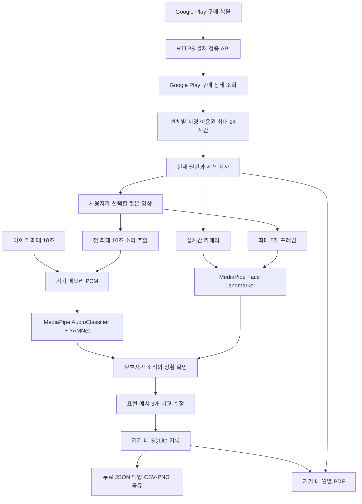

# 지금 내 기분이 그래 — 온디바이스 구조와 엔진 사용 현황

기준: **Android 0.4.0 소스 · 2026-09-30 · 로컬 통합 QA 완료, 실제 Play·ARM 미검증**. 결과는 [0.4.0 QA 보고서](Jigeum-QA-0.4.0.md)에 기록한다. 아래 내용은 구현 설명이며 테스트 통과·실서비스 검증 완료를 선언하지 않는다. 출시·Play 제출·검증 API 배포는 보류한다.

사용자 결정은 외부 아기 기록 DB와 앱 로그인 없이 기기 안에 저장하는 것이다. 결제 상태를 확인하는 별도 통신 경로는 기록 저장과 분리한다.

## 1. 데이터 흐름

기록·메모·미디어가 결제 검증 API로 가는 경로는 없다. 실시간 카메라와 소리를 결합해 영아 의도를 판정하는 모델도 없다. 영상의 시각 단서와 소리 후보는 보호자의 확인을 돕는 자료다.

| 영역 | 현재 0.4.0 구현 | 소스 |
|---|---|---|
| 기록 | 앱 전용 SQLite, 최대 10,000건. 시각·소리·상황·메모·문장·입력 경로·모델 단서, 별도 월령 메타데이터 | `MoaAndroid/.../ObservationStore.kt` |
| 저장 실행 | IO dispatcher, 같은 DB를 쓰는 인스턴스 간 Mutex, SQLite 트랜잭션. 과거 SharedPreferences 기록 이전 후 정상 이전 사본 정리 | `ObservationStore.kt` |
| 삭제 | 개별/전체 삭제, 해당 복구 사본 정리, 전체 삭제 시 월령·표현 이력 해제. SQLite secure_delete 사용. 앱 관리 공유 캐시도 정리 | `ObservationStore.kt`, `MainActivity.kt`, `MemoryArtifacts.kt` |
| 원본 미디어 | 녹음·추출 PCM·카메라 프레임 일시 처리. 선택 영상은 원래 URI에서 읽고 앱에 복사하지 않음 | `SoundAnalyzer.kt`, `VideoAudioDecoder.kt`, `VideoImport.kt`, `CameraScan.kt` |
| 무료 이동·공유 | JSON 백업/가져오기, CSV 내보내기, PNG 문장 카드, 주간 요약. 사용자가 시스템 저장/공유 화면에서 목적지 선택 | `RecordTransfer.kt`, `LibraryScreens.kt`, `MemoryArtifacts.kt` |
| 무료/유료 접근 | 녹음·직접 입력·문장 편집/저장·기본 기록 기능 무료. 카메라·저장 영상·PDF는 하나의 전체 이용권을 실행 시점에 확인. 미디어 세션과 이전 콜백 구분 | `AccessPolicy.kt`, `MainActivity.kt`, `CameraScan.kt`, `VideoImport.kt` |
| 유료 아기말북 | 월별 기록·3개 표지 미리보기 무료. 이용권 확인 후 기기에서 PDF 생성. 메모 포함 기본 꺼짐, 최대 300기록·300쪽 | `LibraryScreens.kt`, `MemoryArtifacts.kt` |
| 결제 | Google Play Billing 9.1.0, 상품 `jigeum_album`, 월 자동 갱신/3개월 선불. 실제 가격은 상품 응답 사용 | `BillingManager.kt`, `BillingModels.kt` |
| 자체 네트워크 | HTTPS로 구매 토큰·설치 식별자·패키지·상품 ID 전송, 서명된 짧은 이용권 수신. `INTERNET` 허용, `ACCESS_NETWORK_STATE` 제거 | `PurchaseVerifier.kt`, Manifest |
| 자동 백업 | allowBackup/fullBackupContent 비활성화. Android 12+ cloud-backup/device-transfer에 앱 저장 영역 제외 규칙 | `res/xml/data_extraction_rules.xml` |
| 로컬 보조 상태 | 표현 후보 반복 방지 이력·세션 캐시, 설치 UUID·서명 이용권·캐시 버전·수신 시각·수신 단조시간·부팅 횟수는 SharedPreferences. 구매 토큰 원문은 앱에서 별도 영구 저장하지 않음 | `PhraseEngine.kt`, `PurchaseVerifier.kt` |

앱 삭제·기기 분실 시 서버 복원은 불가능하다. 사용자가 보관한 JSON으로 기록을 옮기고 같은 Google Play 계정으로 구매를 복원한다. Google Play 구매 복원은 아기 기록 복원이 아니다. 앱 밖에 내보내거나 공유한 파일은 앱 내 삭제의 대상이 아니며 해당 앱/저장 위치에서 삭제한다. 모든 제조사의 이전 도구와 Android·SDK 내부 메모리까지 완전 삭제를 보장하지 않는다.

권한이 만료되면 진행 중인 카메라/영상의 캡처·분석을 멈추고 이전 세션의 결과를 버린다. 이미 생성된 초안의 무료 편집·저장은 유지하며 유효한 권한으로 실제 생성을 시작한 PDF는 완료할 수 있다. 이용권 화면에 다녀와도 초안 편집 내용과 앨범의 월·표지·메모 선택을 보존한다. 세부 경계는 [이용권 정책](Jigeum-Access-Policy.md)을 따른다.

## 2. 문장 다양성과 정확도

`PhraseEngine`은 **5개 소리 × 6개 상황**을 구분한다. 조합마다 앞부분 4개와 뒷부분 4개로 **16개 표현**을 구성한다. 새 세션에는 같은 조합에서 최근 제시한 9개를 피해서 3개를 고르며 동일 세션 결과는 최대 128세션 캐시에서 유지한다.

반복을 줄이는 유한한 카피 시스템이다. 계속 사용하면 같은 표현이 다시 나올 수 있고 다른 문장끼리 의미가 비슷할 수도 있다. 무한 생성·개인화 학습·영아 의도 해독을 구현한 것으로 설명하지 않는다. 보호자가 최종 표현을 고치고 저장한다. 월령은 선택·저장 정보이며 추천 알고리즘에 반영하지 않는다.

| 사용자 제공 자료 | 실제 적용 상태 | 제한 |
|---|---|---|
| [YAMNet](https://github.com/tensorflow/models/tree/master/research/audioset/yamnet) | APK에 모델 포함, MediaPipe AudioClassifier로 녹음·영상 오디오 일반 소리 후보 추론 | AudioSet 소리 분류 점수는 영아의 욕구·의도 정확도가 아님 |
| [MediaPipe](https://github.com/google-ai-edge/mediapipe) | tasks-audio와 tasks-vision 1.0.0 사용 | 얼굴·입 열림을 감정/배고픔 판정으로 해석하지 않음 |
| [LiteRT](https://github.com/google-ai-edge/LiteRT) | MediaPipe Tasks가 .tflite 실행 담당. 별도 LiteRT SDK/API 직접 연동 없음 | 직접 가속·최적화 완료라고 부르지 않음 |
| [librosa](https://github.com/librosa/librosa) | 연구·특징 분석 후보로 조사 | Android 앱 의존성이나 실행 코드에 없음 |
| [voc2vec](https://github.com/koudounasalkis/voc2vec) | 후속 비언어 발성 연구/비교 후보 | 탑재·전이학습·성능 벤치마크 미실시 |
| 논문·데이터 자료 | 대상 월령·표현·평가 한계·라이선스 설계 참고 | 모든 자료의 실험 재현·데이터 학습·모델 결합을 의미하지 않음 |

YAMNet 후보 표시 0.20과 울음/웃음 칩 선선택 0.50은 임시 내부 기준이며 6~18개월 영아에 대해 검증된 임계값이 아니다. 미리 선택된 후보도 보호자 확인이 필요하다. 공개 논문의 수치로 현재 앱의 정확도를 계산했다고 주장하지 않는다.

## 3. 백업·입력 방어와 데이터 보존

JSON은 `format=jigeum-observations`, `version=1`, `ageBand`, `records` 형식이다. 스트리밍으로 읽으며 전체 48MiB, 최대 10,000행, 문자열 길이, 허용 source, 정수 timestamp, UTF-8·Unicode, 중복 키·추가 토큰을 확인한다. 디코더가 거대한 단일 문자열을 만들기 전에도 JSON 문자열 토큰은 8,192바이트, 비문자열 토큰은 64바이트로 제한한다. CSV는 수식으로 실행될 수 있는 셀을 무력화하고 따옴표·줄바꿈을 보존한다.

미리보기와 실제 저장은 같은 합치기 규칙을 사용한다. 저장 순간 현재 DB를 다시 읽고 트랜잭션으로 적용해 오래된 미리보기가 기록을 덮어쓰지 않게 한다. 같은 시각의 다른 내용은 같은 날짜 안에서 새 밀리초 ID를 부여하며 재가져오기 중복을 확인한다. 용량·형식 실패 시 기존 기록을 유지한다. 손상된 과거 항목은 복구용으로 보관하고 안내하며 전체 기록 삭제에 포함한다.

PNG/PDF는 전용 앱 캐시에서 만들고 FileProvider 읽기 권한을 시스템 공유에 부여한다. 24시간이 지난 자체 생성 파일은 정리 대상이다. 자동으로 가족 계정에 업로드하거나 동기화하지 않는다.

## 4. 결제 검증 서비스와 몰림 대응

기본 분석·기록은 기기에서 실행하므로 공용 분석 서버가 사용자 수만큼 요청을 받는 구조가 아니다. 기기별 메모리·발열·저장 공간·UI 응답성은 별도 QA 대상이다.

`PlayVerifier`에는 외부 사용자 DB 없는 Node 검증 API 소스가 있다. Google Publisher API에서 실제 상품·요금제·상태·만료를 확인한 후 ECDSA P-256 이용권을 발급한다. 이용권 유효기간은 최대 24시간 또는 구독 만료 중 빠른 시각이다. 앱은 서명·설치·상품·기간을 확인한다. 검증기 소스는 요청 본문/토큰을 로그에 남기지 않지만, 실제 배포 인프라의 접근 로그·보존 정책은 배포 전에 확인해야 한다.

앱은 서명 이용권과 수신 시각·단조시간·부팅 횟수를 같은 SharedPreferences commit으로 저장한다. 캐시 사용 시 수신 때 고정한 잔여기간에서 단조시간 경과를 뺀 값과 서명된 만료 시각까지의 시간 중 짧은 값을 적용한다. 기기 시계를 되돌려도 허용 기간이나 UI 만료 타이머가 연장되지 않게 했으며, 재부팅·기존 형식 캐시·시간 검증 근거 손상은 캐시를 지우고 온라인 재확인을 요구한다. 네트워크 실패는 유효 캐시 안에서만 허용하고 명시적 거절·권한 철회는 신규 유료 작업을 차단한다. 오프라인 중 발생한 새 환불의 반영 지연은 남는다.

현재 소스는 요청 크기 16KiB, 본문/검증 시간 제한, 동시 검증 기본 32개, 연결 수 256개, 소켓 IP 기준 분당 30회 제한과 주소 테이블 상한을 둔다. 같은 구매 토큰의 동시 Google 조회를 합치고 OAuth 토큰 요청도 중복 수행을 줄인다. 이는 코드의 방어선이며 실제 트래픽 수용량/SLA를 보증하지 않는다. 프록시 뒤에서는 배포 경계의 실제 클라이언트별 제한과 HTTPS 구성이 필요하다.

앱의 검증 URL·공개 키 기본값은 비어 있고 현재 검증 API를 배포하지 않았다. 설정이 없으면 구매와 유료 권한 부여를 막고 무료 기능을 유지한다. 실제 Play 구매·복원·환불·보류·취소는 서비스와 상품이 준비된 후 검증해야 한다. 모의/서명 테스트와 실제 결제 검증은 구분한다.

## 5. 현재 검증 범위

0.4.0 통합 빌드, Android 계측 72개, 서버 16개, 무료 UI 7유형의 로컬 검증을 완료했다. 유료 화면 전환·만료·복원은 androidTest의 테스트 대역으로 검증했다. 결과는 [0.4.0 QA 보고서](Jigeum-QA-0.4.0.md)와 실행 증거에 기록한다. 이 문서는 테스트 통과 증거를 대신하지 않는다. 실물 ARM Android 기기와 실제 Google Play 거래 검증, 운영 API 연결과 업로드 서명 설정은 별도 항목이다. 출시·제출은 후속 작업으로 남긴다.
